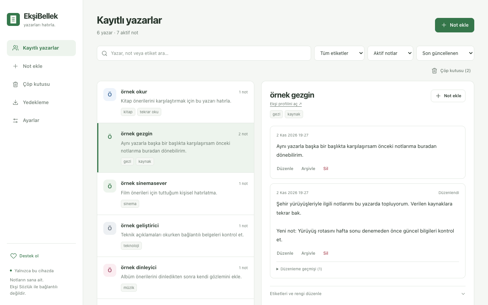

# EkşiBellek

Ekşi Sözlük yazarları için kişisel hafızan. Bir yazara not bırak; başka bir başlıkta yeniden karşılaştığında hatırla.

**Ücretsiz · Açık kaynak · MIT lisanslı · Hesapsız · Yerel depolama**

[Proje sayfası](https://togiwan.github.io/eksibellek/) · [Gizlilik](https://togiwan.github.io/eksibellek/privacy.html) · [Sürümler](https://github.com/togiwan/eksibellek/releases) · [Sorun bildir](https://github.com/togiwan/eksibellek/issues)



## Neler yapar?

- Yazar adının başındaki küçük düğmeden o yazara ait notları açar.
- Bir yazara birden fazla tarihli not, etiket ve renk ekler.
- Kullanıcı adı, not içeriği ve etiketlerde arama yapar.
- Notu kaynak entry bağlantısıyla kaydeder; düzenleme geçmişini korur.
- Arşivleme ve geri getirme sunar.
- Silinen notları otomatik boşalmayan çöp kutusunda saklar; geri getirme, onaylı kalıcı silme ve çöp kutusunu boşaltma sağlar.
- Tüm kayıtları, arşivi, çöp kutusunu ve geçmişi JSON ile dışa/içe aktarır. Çakışmaları önizler; mevcut metnin üzerine sessizce yazmaz.
- Açık, koyu ve sistem temasını destekler.

## Kurulum

Chrome Web Store başvurusu hazırlanıyor. Bu sırada [Sürümler](https://github.com/togiwan/eksibellek/releases) sayfasından en güncel ZIP dosyasını indirip elle kurabilirsin:

1. ZIP dosyasını kalıcı olarak kullanacağın bir klasöre çıkar.
2. Chrome'da `chrome://extensions` sayfasını açıp **Geliştirici modu**nu etkinleştir.
3. **Paketlenmemiş öğe yükle** ile `manifest.json` dosyasının bulunduğu klasörü seç.
4. Açık Ekşi Sözlük sayfalarını yenile ve EkşiBellek'i araç çubuğuna sabitle.

Kaynak kodundan kuruyorsan doğrudan `extension/` klasörünü seç. ZIP'i veya proje kökünü seçme.

## Kullanım

**Not ekle:** Araç çubuğu ikonuna tıkla, rumuz ve notu girip kaydet. Etiket, renk ve kaynak seçenekleri açılır bölümde bulunur. Başlık üzerinde yazarın yanındaki düğmeden de not ekleyebilirsin.

**Yazarlar:** Kayıtlarını ara, etiketle filtrele, düzenle veya arşivle. Sağ üstteki genişletme düğmesi bütün defteri ayrı bir sekmede açar.

**Çöp kutusu:** Not kartındaki **Sil** notu çöp kutusuna taşır. Yazar ayrıntısındaki **Yazarın tüm notlarını sil** arşivdeki notları da kapsar. **Yazarlar > Çöp kutusu** veya geniş ekrandaki menüden geri getirebilirsin. Arşivden silinen bir not arşive döner. **Kalıcı sil** ve **Çöp kutusunu boşalt** ayrıca onay ister; geri alınamaz.

**Yedekleme:** **JSON dosyasını indir** bütün yazarları, notları, arşivi, çöp kutusunu ve geçmişi içerir. İçe aktarma önizlemesi yeni, aynı ve çakışan notları gösterir. Aynı dosyayı tekrar yüklemek eşdeğer notları çoğaltmaz. Eski bir yedekteki aktif sürüm çöp kutusundaki sürümle çakışırsa iki kopyayı korumak aktif bir kopya ekleyebilir; durum etiketlerini kontrol et.

Yeni yedekler v2 biçimindedir ve 0.1.7 veya üzerini gerektirir; eski v1 yedekler de desteklenir. [20 örnek yazarlı test JSON'u](samples/eksibellek-test-20-yazar.json) tamamen temsili kayıtlar içerir ve `test` etiketiyle ayırt edilir.

## Kayıtların nerede durur?

Notlar, tercihler ve yeni not taslağı **aynı Chrome profilinin yerel eklenti alanında** tutulur. Normal tarayıcı kapatma/açmada korunur. Bir sunucuya gönderilmez; hesap, analitik, reklam ve otomatik bulut senkronizasyonu yoktur.

**Eklentiyi kaldırmak veya Chrome profilini silmek yerel kayıtları siler.** Düzenli JSON yedeği al ve dosyanın indirildiğini kontrol et. JSON dosyaları açık metindir. Çöp kutusu da yerel depolama kotasını kullanır; kota dolarsa son değişiklik reddedilir ve önceki kayıt korunur.

Paketlenmemiş kurulumu güncellerken **aynı klasörü ve aynı Chrome profilini** kullan; `chrome://extensions` ekranında **Yeniden yükle** düğmesine bas. Ardından Ekşi sekmelerini yenile. Klasörü taşımak veya mağaza sürümüne geçmek farklı bir eklenti kimliği oluşturabilir: geçişten önce JSON yedeğini al, yeni kurulumda içe aktar ve kayıtlarını doğrula.

Ayrıntılar: [yerel veri açıklaması](PRIVACY.md).

## Gönüllü destek

EkşiBellek ücretsiz kalır. **Ayarlar > Destek seçenekleri** içinde TRX (TRON) ve USDT (TRON/TRC20) için geliştiricinin alıcı adresini kopyalayabilirsin. Transfer kendi cüzdanında yapılır; eklenti cüzdana bağlanmaz ve ödeme başlatmaz.

## Geliştirme

Çalışma zamanında bağımlılık veya derleme adımı yoktur. Manifest V3, düz JavaScript, HTML ve CSS kullanır. Geliştirme için Node.js 20+ ve Python 3 yeterlidir.

```sh
npm test
npm run check
npm run package
```

`npm run package`, yalnızca `extension/` dosyaları ve lisans bildirimini içeren `dist/eksibellek-<sürüm>.zip` üretir. Kişisel JSON dosyaları, örnekler ve testler pakete alınmaz. Paketleme sabit ZIP meta verileri kullanır.

`npm run check:persistence`, Playwright ve Chromium kuruluysa ayrı geçici profillerde kapanma/açılma, işçi yeniden başlatma, eş zamanlı kayıt, ani tarayıcı kapanması, kota aşımı ve JSON kurtarmayı denetler. `PLAYWRIGHT_MODULE`, `CHROMIUM_EXECUTABLE` ve `PERSISTENCE_OUTPUT_DIR` ile yerel araç yollarını belirt. Test yalnızca kendi başlattığı ve profilini doğruladığı süreçleri sonlandırır. Fiziksel güç kaybı veya disk arızası bu testle doğrulanmaz.

Katkı için [CONTRIBUTING.md](CONTRIBUTING.md), mağaza başvurusu için [yayın notları](docs/chrome-web-store.md).

## Sınırlar

- Yalnızca `https://eksisozluk.com/*` ve `https://www.eksisozluk.com/*` desteklenir.
- Sayısal yazar kimliği varsa eşleştirmede önceliklidir; farklı sayısal hesaplar aynı rumuzu kullansa da notlarını paylaşmaz. Kimliği henüz bilinmeyen elle eklenmiş kayıtların rumuz değişimini takip etmesi garanti edilmez.
- Site yapısı değişirse yazar düğmelerinin uyarlanması gerekebilir.
- Yerel depolama kotası geçerlidir. İçe aktarma dosya sınırı 20 MB'dir; gerçek depolama kotası daha düşük olabilir.
- Otomatik bulut yedeği, cihazlar arası senkronizasyon ve notlar için ek parola/disk şifrelemesi yoktur.

EkşiBellek, Ekşi Sözlük'ün resmî ürünü değildir ve onunla bağlantılı değildir. Kod ve özgün görseller [MIT](LICENSE) lisanslıdır.
